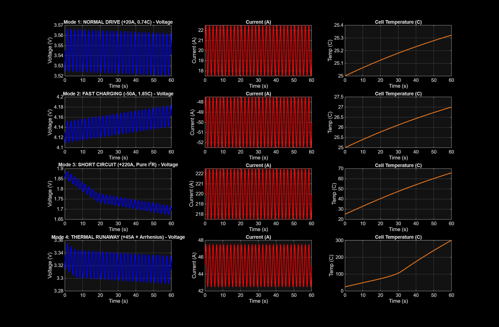

# EdgeAI-EV-BMS-Simulink

Real-time **EV Battery Management System (BMS)** fault classification and thermal runaway anomaly detection in **MATLAB / Simscape / Simulink**, powered by **Edge Impulse TinyML** using the [**EdgeImpulse-MATLAB-Simulink-Toolbox**](https://github.com/Vikram4405/EdgeImpulse-MATLAB-Simulink-Toolbox).

---

## Overview

This project demonstrates a complete **closed-loop TinyML workflow** inside Simulink for electric vehicle battery safety:

1. **Physical Plant Simulation (Simscape Electrical + Thermal):** Models a 27 Ah NMC EV lithium-ion cell with electrical load dynamics, ohmic heating ($I^2 R_0$), convective cooling, and an Arrhenius exothermic thermal runaway cascade.
2. **Automated Cloud Data Collection (`EI_Data_Logger`):** Streams 3-channel BMS telemetry (`Voltage_V`, `Current_A`, `Temp_C`) at **20 Hz** directly from Simulink to Edge Impulse Studio.
3. **Live Edge AI Inference + Anomaly Detection (`EI_Classifier`):** Compiles the trained Edge Impulse C++ library (4-class Neural Network + K-means Anomaly Detection) into a native MEX binary and runs real-time fault classification directly inside Simulink with a live Prediction Monitor HUD.

---

## Simulated Battery Operating & Fault Modes

Switch interactively between all 4 modes on the Simulink canvas using the cascaded Manual Switches:

| Mode | Label | Electrical & Thermal Dynamics |
| :--- | :--- | :--- |
| **1** | `Normal_Drive` | `+20 A` (~0.74 C) nominal discharge with driving current ripple & ohmic heating |
| **2** | `Fast_Charging` | `-50 A` (~1.85 C) DC fast charge (`V ~ 4.15 V`) with ohmic heating |
| **3** | `Short_Circuit` | `+220 A` (~8.1 C) external short circuit (`V < 2.0 V`) with rapid $I^2 R_0$ Joule heating |
| **4** | `Thermal_Runaway` | `+45 A` internal fault load + Arrhenius exothermic heat cascade |
| **+ Anomaly** | *Out-of-Distribution* | K-means anomaly detector flags unseen/extreme electrical or thermal faults (`anomaly > 0`) |

### 4-State Simscape Verification



---

## Sensor Fusion & Impulse Configuration

* **Channels (3):** `Voltage_V`, `Current_A`, `Temp_C`
* **Sampling Frequency:** `20 Hz` (`MaxStep = 0.05 s`)
* **Window Size:** `2.0 s` (`40 samples × 3 channels = 120 raw features`)
* **Outputs:** 4-class classification probabilities (`Fast_Charging`, `Normal_Drive`, `Short_Circuit`, `Thermal_Runaway`) + K-means anomaly score

---

## Repository Contents

| File | Description |
| :--- | :--- |
| `ev_battery_sim.slx` | Flat Simscape Electrical + Thermal EV Battery BMS Simulink model wired with Edge Impulse blocks |
| `create_ev_battery_simulink.m` | Programmatic MATLAB script to regenerate `ev_battery_sim.slx` from scratch |
| `verify_ev_battery_simulink.m` | Automated 4-state verification script that simulates all modes and plots Voltage, Current & Temp |
| `ev_battery_verification.png` | Verified 4-state waveform output across all 4 battery operating/fault modes |

---

## Quick Start

### Prerequisites
* **MATLAB & Simulink** with **Simscape** and **Simscape Electrical**
* **C++20 Compiler** (e.g., Microsoft Visual Studio Build Tools on Windows) for MEX compilation
* [**EdgeImpulse-MATLAB-Simulink-Toolbox**](https://github.com/Vikram4405/EdgeImpulse-MATLAB-Simulink-Toolbox)

### Run the Model
1. Clone both repositories:
   ```bash
   git clone https://github.com/Vikram4405/EdgeImpulse-MATLAB-Simulink-Toolbox.git
   git clone https://github.com/Vikram4405/EdgeAI-EV-BMS-Simulink.git
   ```
2. In MATLAB, add the toolbox and open the BMS model:
   ```matlab
   addpath('path/to/EdgeImpulse-MATLAB-Simulink-Toolbox/toolbox');
   addpath('path/to/EdgeAI-EV-BMS-Simulink');
   open_system('ev_battery_sim');
   ```
3. **Collect Data (Optional):** Double-click `EI_Data_Logger`, paste your Edge Impulse API key, select a mode via the manual switches, and click **Run (▶)**.
4. **Run Live Edge AI Inference:** Double-click `EI_Classifier`, click **Browse & Build Edge Impulse .ZIP Model...** to import your trained C++ deployment `.zip`, and click **Run (▶)** to monitor live fault classifications and anomaly scores in real time.

---

## Powered By

Built with [**EdgeImpulse-MATLAB-Simulink-Toolbox**](https://github.com/Vikram4405/EdgeImpulse-MATLAB-Simulink-Toolbox) — Universal 2-Way Edge Impulse ↔ MATLAB & Simulink Plugin.
